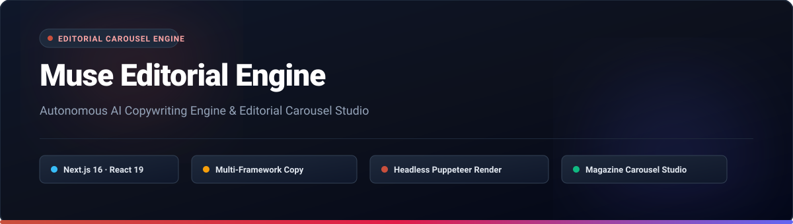
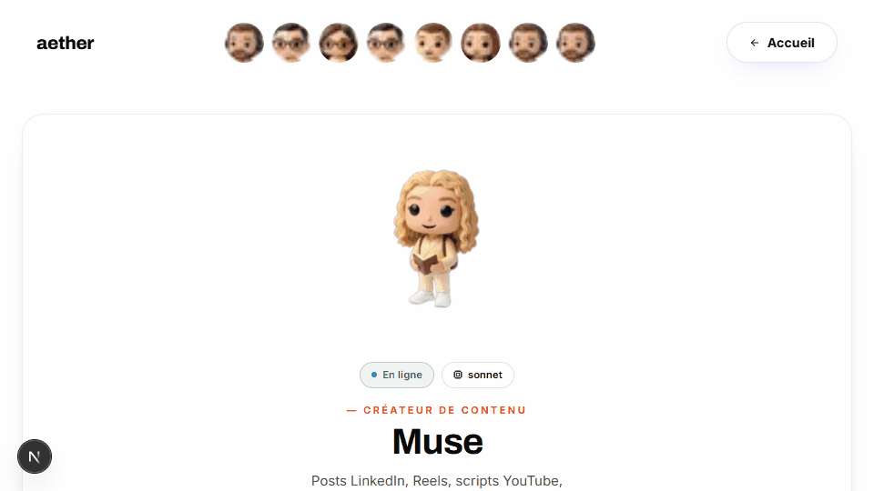
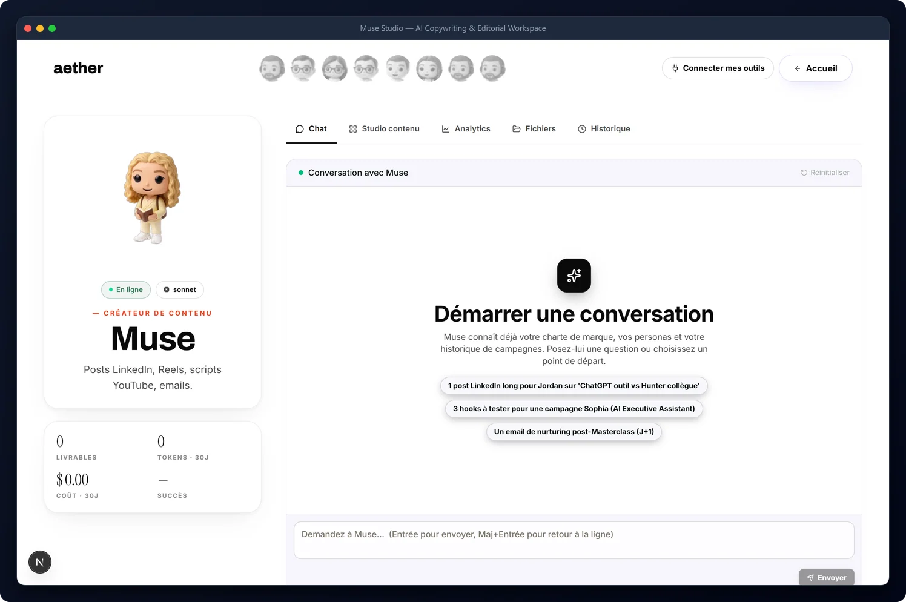
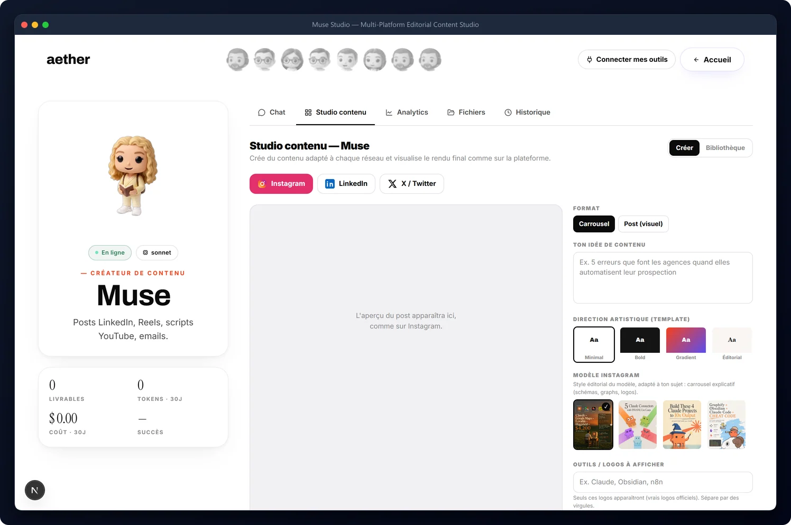
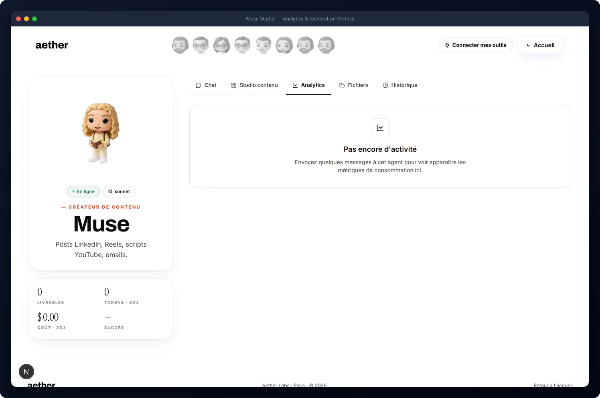
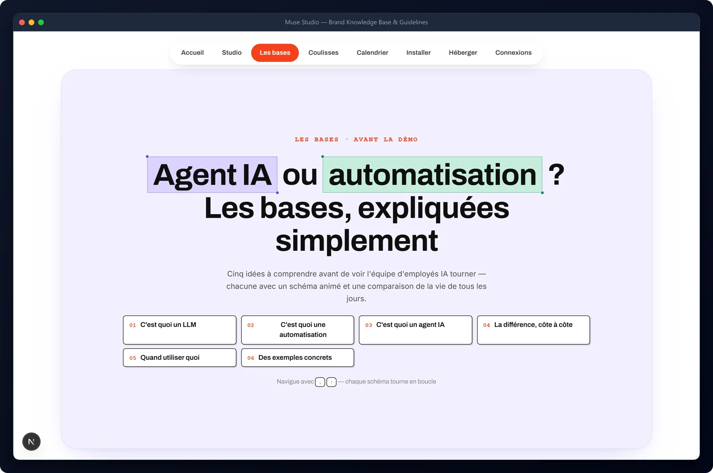
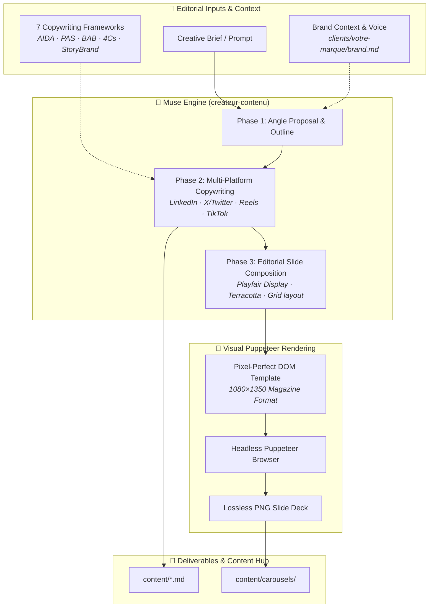

<div align="center">



[](https://nextjs.org/)
[](https://react.dev/)
[](https://www.typescriptlang.org/)
[](https://console.anthropic.com/)
[](https://github.com/)
[](#-license--attribution)

**Autonomous AI Copywriting Engine & Editorial Carousel Studio built on the AetherOS Multi-Agent Architecture**

[Live Demo](#-live-demo) · [Screenshots](#-screenshots) · [Architecture](#-architecture) · [Features](#-overview) · [Quick Start](#-how-to-install--configure) · [Customize](#-how-to-create--customize-agents)

</div>

---

## 🌟 Overview

**Muse** is an autonomous AI copywriting engine and specialized editorial carousel studio. Designed for content creators, marketing agencies, and B2B growth teams, Muse converts raw briefs into conversion-focused copy across LinkedIn, X/Twitter, Instagram Reels, TikTok, and YouTube — and generates pixel-perfect magazine-style editorial carousel slides rendered directly from HTML to PNG using headless Puppeteer.

### Key Capabilities & Specialized Studio UI

### 1. Multi-Framework Copywriting
Muse applies proven copywriting frameworks tailored to each specific format:
- **AIDA** (Attention, Interest, Desire, Action) — Promotional campaigns and conversion emails.
- **PAS** (Problem, Agitate, Solution) — High-impact B2B LinkedIn posts and landing page copy.
- **BAB** (Before, After, Bridge) — Case studies, testimonials, and customer transformation stories.
- **Hook-Story-Offer** — Short-form video scripts (Instagram Reels, TikTok, YouTube Shorts).
- **FAB** (Features, Advantages, Benefits) — Product marketing and feature highlights.
- **4Cs** (Clear, Concise, Compelling, Credible) — Quality assurance pass on all draft copy.
- **StoryBrand** — Comprehensive long-form video scripting.

Every post includes at least two tested hook variations, structured character count compliance, and clear calls to action.

### 2. Editorial Magazine Carousel Studio (`ContentStudio`)
Unlike standard AI image generators that distort and hallucinate typography, Muse utilizes a dedicated **HTML-to-PNG Puppeteer rendering pipeline**:
- **Magazine Aesthetic**: Elegant cream background with subtle 72px millimeter graph paper grid.
- **Typographic Precision**: Massive high-contrast Playfair Display 900 headings paired with Inter body copy.
- **Terracotta Accents (`#C94F3C`)**: Italic serif text emphasis (`*emphasis*`), handcrafted underlines (`_underlined_`), and numbered header pills (`1/5`).
- **Zero Hallucination**: Renders real DOM elements into 1080×1350 PNG slides with 100% spelling and character fidelity.
- **Interactive Slide Preview**: Live preview, reorder, edit, and export slides directly inside `aether-studio`.

### 3. Plan-First Autonomous Workflow
Muse never produces unvetted copy blindly. The engine submits a structured content outline and angle proposal first. Once confirmed, it writes production-ready markdown deliverables directly to the `content/` workspace directory.

---

## ⚡ Live Demo



---

## 📸 Screenshots

<table width="100%">
  <tr>
    <td width="50%" align="center">
      <h4>1. Muse Editorial Workspace</h4>
      
      <p><em>Interactive Muse chat interface featuring editorial prompt shortcuts, live streaming copy generation, and token tracking.</em></p>
    </td>
    <td width="50%" align="center">
      <h4>2. Multi-Platform Content Studio</h4>
      
      <p><em>Visual content creation workbench supporting LinkedIn, Instagram, and X/Twitter formats with real-time template styling.</em></p>
    </td>
  </tr>
  <tr>
    <td width="50%" align="center">
      <h4>3. Analytics &amp; Generation Metrics</h4>
      
      <p><em>Usage statistics and token monitoring tracking editorial output volume, Claude Sonnet consumption, and system performance.</em></p>
    </td>
    <td width="50%" align="center">
      <h4>4. Brand Knowledge Base &amp; Context Repository</h4>
      
      <p><em>Brand voice and persona repository ensuring all generated copy matches company voice, forbidden words, and target ICPs.</em></p>
    </td>
  </tr>
</table>

---

## 🏛️ Architecture



### Directory Layout

```
muse-editorial-engine/
├── .claude/
│   └── agents/
│       └── createur-contenu.md   # Muse system prompt, framework rules, & formatting constraints
├── aether-studio/                # Next.js 16 full-stack Studio application
│   ├── src/
│   │   ├── app/                  # App Router: API routes (/api/chat, /api/content/generate)
│   │   ├── components/           # UI: ContentStudio, CarouselSlidesPanel, AgentChat
│   │   └── lib/                  # Central registry, Puppeteer carousel engine, paths
│   ├── .env.example              # Environment blueprint with template lock
│   └── package.json              # Studio dependencies (Next 16, React 19, Tailwind CSS 4)
├── clients/
│   └── votre-marque/
│       └── brand.md              # Brand guide: voice, ICP, positioning, and guardrails
├── content/                      # Storage for generated copy and exported carousel assets
├── docs/                         # Real UI screenshots & architectural assets
│   └── screenshots/
├── CLAUDE.md                     # Zero-friction onboarding instructions for Claude Code
├── .gitignore                    # Root repository ignore rules
└── README.md                     # Product documentation & technical specifications
```

### Architecture Highlights
- **Agent Specification (`.claude/agents/createur-contenu.md`)**: Defines Muse's behavioral guidelines, tone, tool permissions, and strict formatting invariants.
- **Template Lock (`OWNED_AGENT=createur-contenu`)**: Binds `aether-studio` exclusively to the Muse persona, focusing the workspace on content production and locking other agents in the UI.
- **Brand Context Injection (`clients/votre-marque/brand.md`)**: Customizes tone of voice, forbidden vocabulary, target ICP, and stylistic preferences.

---

## 🛠️ How to Install & Configure

### 1. Prerequisites
- **Node.js**: v20 LTS or higher (`node -v`)
- **Package Manager**: npm (bundled with Node.js) or pnpm
- **Anthropic API Key**: Available at [Anthropic Console](https://console.anthropic.com/settings/keys)

### 2. Installation
Navigate into the web application folder and install dependencies:

```bash
cd aether-studio
npm install
```

### 3. Environment Configuration
Create your local environment configuration:

```bash
cp .env.example .env.local
```

Open `.env.local` and add your Anthropic Claude API key:

```env
# ================= REQUIRED CONFIGURATION =================
ANTHROPIC_API_KEY="sk-ant-api03-..."

# Standalone Agent Template Lock
OWNED_AGENT=createur-contenu
NEXT_PUBLIC_OWNED_AGENT=createur-contenu

# ================= OPTIONAL MODEL OVERRIDES =================
ANTHROPIC_MODEL_SONNET=claude-sonnet-4-20250514
ANTHROPIC_MODEL_OPUS=claude-opus-4-20250514

# Optional upgrade URL for locked agent navigation
NEXT_PUBLIC_UNLOCK_URL=
```

---

## 🚀 How to Use

### 1. Launch the Studio
```bash
cd aether-studio
npm run dev
```

Open [http://localhost:3000](http://localhost:3000) in your browser. Because `OWNED_AGENT=createur-contenu` is enabled, you are routed straight into Muse's workspace.

### 2. Studio Workflows
- **Editorial Chat**: Prompt Muse with high-level ideas (e.g., *"1 post LinkedIn long sur ChatGPT outil vs collègue IA"* or *"3 hooks percutants pour une campagne B2B"*). Muse proposes angles, outlines, and then crafts the final post.
- **Visual Content Studio Tab**: Click **Studio contenu** in the top navigation of the agent panel to access the visual post & carousel builder:
  - Select your destination network: **LinkedIn**, **Instagram**, or **X / Twitter**.
  - Choose between **Carrousel** or **Post (visuel)**.
  - Select an Art Direction preset: **Minimal**, **Bold**, **Gradient**, or **Éditorial**.
  - Type your topic, select reference design styles, and generate production-ready slides rendered with headless Puppeteer.
- **Content Deliverables**: Generated copy and slide exports are systematically saved to `content/` for easy retrieval.

---

## 🧠 How to Create & Customize Agents

You can modify Muse or add custom creative personas to the studio:

### 1. Adjusting Copywriting Heuristics
Edit `.claude/agents/createur-contenu.md` to tune:
- **Hook Formats**: Add bespoke hook templates (e.g., Contrarian, Story, Metric-driven).
- **Structure Constraints**: Enforce specific character limits or line-break spacing rules.
- **Tone Guidelines**: Adjust French/English vocabulary choices, formality levels, and emojis.

### 2. Customizing Carousel Art Direction
Carousel styles are defined in `aether-studio/src/lib/carousels/template.ts` and `ContentStudio.tsx`. You can:
- Add custom color palettes, brand typography, and slide background gradients.
- Modify the 1080×1350 aspect ratio or margin padding for specific platforms.
- Embed custom SVG brand logos and author watermark badges.

### 3. Personalizing Brand Tone
Edit `clients/votre-marque/brand.md`:
- Set your value proposition, customer personas, and product features.
- Define words to avoid and stylistic guardrails so all generated content matches your brand voice.

---

## ⚙️ Environment Variables Reference

| Variable | Required | Default | Description |
| :--- | :---: | :---: | :--- |
| `ANTHROPIC_API_KEY` | **Yes** | — | Anthropic Claude API Key powering chat and copywriting generation. |
| `OWNED_AGENT` | **Yes** | `createur-contenu` | Standalone template lock enforcing Muse as the active agent. |
| `NEXT_PUBLIC_OWNED_AGENT` | **Yes** | `createur-contenu` | Client-side agent lock for the Next.js frontend studio view. |
| `ANTHROPIC_MODEL_SONNET` | Optional | `claude-sonnet-4-20250514` | Custom Claude Sonnet model identifier override. |
| `ANTHROPIC_MODEL_OPUS` | Optional | `claude-opus-4-20250514` | Custom Claude Opus model identifier override. |
| `NEXT_PUBLIC_UNLOCK_URL` | Optional | — | Redirect URL for upgrade prompts or multi-agent suite access. |

---

## 📄 License & Attribution

Built on the **AetherOS Autonomous Agent Framework**. Distributed under the [MIT License](LICENSE).
